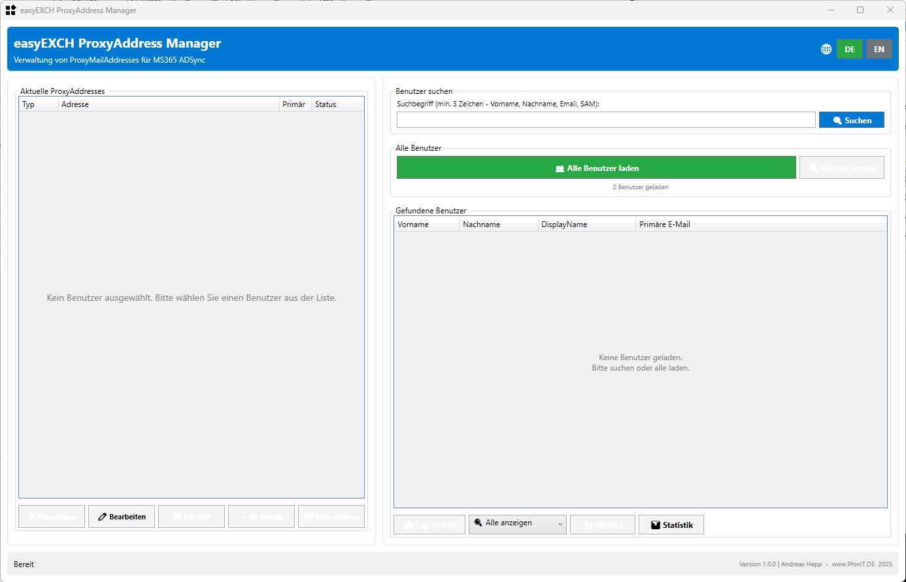

# easyEXCH ProxyAddress Manager


**Tool zur Verwaltung von ProxyMailAddresses für Microsoft 365 ADSync**

Entwickelt von **Andreas Hepp** | [www.phinit.de](https://www.phinit.de) | 08.12.2025



---

## 📋 Inhaltsverzeichnis

- [Übersicht](#-übersicht)
- [Features](#-features)
- [Screenshots](#-screenshots)
- [Installation](#-installation)
- [Verwendung](#-verwendung)
- [MS365 ADSync Validierung](#-ms365-adsync-validierung)
- [Logging](#-logging)
- [EXE-Konvertierung](#-exe-konvertierung)
- [Systemanforderungen](#-systemanforderungen)
- [Bekannte Einschränkungen](#-bekannte-einschränkungen)
- [Troubleshooting](#-troubleshooting)
- [Changelog](#-changelog)
- [Lizenz](#-lizenz)
- [Autor](#-autor)

---

## 🎯 Übersicht

**easyEXCH ProxyAddress Manager** ist ein PowerShell-basiertes Tool mit moderner WPF-GUI zur Verwaltung von ProxyMailAddresses in Active Directory. Es wurde speziell für Umgebungen entwickelt, in denen kein lokaler Exchange Server mehr vorhanden ist, aber MS365 ADSync verwendet wird.

### Hauptmerkmale

- ✅ **Moderne WPF-GUI** - Benutzerfreundliche Oberfläche im easyEXCH-Design
- ✅ **Mehrsprachig** - Deutsch und Englisch mit Live-Umschaltung (🌐 DE/EN)
- ✅ **Live-Suche** - Automatische Suche ab 3 Zeichen
- ✅ **MS365-Validierung** - Prüft ProxyAddresses auf ADSync-Kompatibilität
- ✅ **Vollständiges Logging** - Alle Änderungen werden protokolliert
- ✅ **EXE-Konvertierung** - PS2EXE-kompatibel für einfache Verteilung
- ✅ **Legacy Exchange Support** - Berücksichtigt alte Exchange-Attribute
- ✅ **Intelligente Domänen-Filterung** - Nur öffentliche TLDs bei ProxyAddress-Eingabe

---

## 🚀 Features

### Benutzer-Verwaltung

- **Alle Benutzer laden** - Lädt alle aktiven AD-Benutzer
- **Intelligente Suche** - Sucht in Vorname, Nachname, DisplayName, E-Mail, SAM-Account und UPN
- **Live-Suche** - Automatische Suche ab 3 Zeichen mit 500ms Verzögerung
- **Tabellarische Darstellung** - Übersichtliche Anzeige mit Vorname, Nachname, DisplayName und primärer E-Mail
- **OU-Filter** - Optional: Suche in bestimmten OUs einschränken
- **Domain Controller Auswahl** - Optional: Spezifischen DC verwenden

### ProxyAddress-Verwaltung

#### ➕ Hinzufügen
- Dialog zur Eingabe neuer ProxyAddresses
- Typ-Auswahl: SMTP: (primär), smtp: (sekundär), SIP:, X500:
- Automatische Konvertierung alter primärer Adressen zu sekundären

#### ✏️ Bearbeiten
- Bestehende ProxyAddresses ändern
- Atomare Operation: Alte löschen, neue hinzufügen
- Automatisches Rollback bei Fehlern

#### 🗑️ Löschen
- Löschen mit Sicherheitsabfrage
- Warnung bei primären SMTP-Adressen

#### ⭐ Als Primär setzen
- Sekundäre SMTP-Adressen zu primären machen
- Automatische Konvertierung der alten primären zu sekundär
- Aktualisierung des Mail-Attributs

#### 🔄 Aktualisieren
- Lädt aktuelle ProxyAddresses vom AD neu

### MS365 ADSync Validierung

#### Pro Benutzer
- Automatische Validierung bei Auswahl
- Anzeige von Fehlern und Warnungen
- Farbcodierte Status-Anzeige (✅ Grün = OK, ❌ Rot = Fehler)

#### Bulk-Prüfung
- **ADSync-Prüfung** für alle geladenen Benutzer
- Detailliertes Ergebnis-Fenster mit:
  - Zusammenfassung (Kompatibel/Fehler/Warnungen)
  - Tabelle mit allen Benutzern
  - Auflistung aller Fehler und Warnungen

### Validierungs-Kriterien

✅ **Geprüft wird**:
- Vorhandensein von ProxyAddresses
- Primäre SMTP-Adresse vorhanden (SMTP: Großbuchstaben)
- Keine mehrfachen primären SMTP-Adressen
- Mail-Attribut stimmt mit primärer SMTP überein
- E-Mail-Format (RFC-konform)
- Unerlaubte Zeichen
- Länge (max. 254 Zeichen)
- Legacy Exchange Attribute (msExchRecipientTypeDetails, legacyExchangeDN)
- MailNickname vorhanden
- TargetAddress für Remote Mailboxes

⚠️ **Legacy Exchange Unterstützung**:
- Erkennt alte Exchange-Attribute
- Prüft X500-Adressen für Migration
- Warnt bei fehlenden Legacy-Konvertierungen

---

## 📸 Screenshots

### Hauptfenster
```
┌─────────────────────────────────────────────────────────────┐
│ easyEXCH ProxyAddress Manager                               │
├─────────────────────────────────────────────────────────────┤
│                                                             │
│  ProxyAddress Management    │  Benutzer suchen             │
│  ┌──────────────────────┐   │  ┌──────────────────────┐   │
│  │ Max Mustermann       │   │  │ Suchbegriff: adm     │   │
│  │ ✅ MS365 Kompatibel  │   │  │ OU Filter: (leer)    │   │
│  ├──────────────────────┤   │  ├──────────────────────┤   │
│  │ ProxyAddresses:      │   │  │ 👥 Alle laden │🔍 ADSync│
│  │ SMTP:max@domain.com  │   │  ├──────────────────────┤   │
│  │ smtp:max@old.com     │   │  │ Vorname │ Nachname   │   │
│  │ X500:/o=Exchange...  │   │  │ Max     │ Mustermann │   │
│  └──────────────────────┘   │  │ Erika   │ Musterfrau │   │
│  [➕][✏️][🗑️][⭐][🔄]      │  └──────────────────────┘   │
└─────────────────────────────────────────────────────────────┘
```

---

## 💾 Installation

### Voraussetzungen

- Windows 10/11 oder Windows Server 2016+
- PowerShell 5.1
- Active Directory PowerShell Module
- Berechtigungen zum Ändern von AD-Benutzern

### Schnellstart

1. **Repository klonen**:
   ```powershell
   git clone https://github.com/IhrUsername/easyEXCH-ProxyAddress.git
   cd easyEXCH-ProxyAddress
   ```

2. **Script ausführen**:
   ```powershell
   .\easyEXCH-PMA_V1.0.0.ps1
   ```

3. **Optional: Als EXE kompilieren** (siehe [EXE-Konvertierung](#-exe-konvertierung))

---

## 🎮 Verwendung

### Benutzer suchen

1. **Alle Benutzer laden**:
   - Klick auf "👥 Alle Benutzer laden"
   - Optional: Domain Controller oder OU-Filter angeben

2. **Gezielt suchen**:
   - Mindestens 3 Zeichen eingeben
   - Automatische Live-Suche nach 500ms
   - Sucht in: Vorname, Nachname, DisplayName, E-Mail, SAM-Account, UPN

3. **Benutzer auswählen**:
   - Klick auf Benutzer in der Tabelle
   - ProxyAddresses werden automatisch geladen
   - Validierung wird durchgeführt

### ProxyAddress hinzufügen

1. Benutzer auswählen
2. Klick auf **➕** Button
3. Typ auswählen (SMTP:, smtp:, SIP:, X500:)
4. Adresse eingeben (z.B. `max.mustermann@newdomain.com`)
5. Klick auf "Hinzufügen"

**Tipp**: 
- `SMTP:` (Großbuchstaben) = Primäre Adresse
- `smtp:` (Kleinbuchstaben) = Sekundäre Adresse

### ProxyAddress bearbeiten

1. Benutzer auswählen
2. ProxyAddress in der Liste auswählen
3. Klick auf **✏️** Button
4. Neue Adresse eingeben (mit Typ, z.B. `smtp:neue@domain.com`)
5. Klick auf "Speichern"

### ProxyAddress löschen

1. Benutzer auswählen
2. ProxyAddress in der Liste auswählen
3. Klick auf **🗑️** Button
4. Bestätigen

⚠️ **Warnung**: Beim Löschen der primären SMTP-Adresse erscheint eine zusätzliche Warnung!

### Als Primär setzen

1. Benutzer auswählen
2. **Sekundäre** SMTP-Adresse auswählen (smtp:)
3. Klick auf **⭐** Button
4. Bestätigen

**Automatisch**:
- Alte primäre wird zu sekundärer (SMTP: → smtp:)
- Ausgewählte wird zu primärer (smtp: → SMTP:)
- Mail-Attribut wird aktualisiert

### ADSync-Prüfung

1. Benutzer laden (alle oder suchen)
2. Klick auf **🔍 ADSync prüfen**
3. Ergebnis-Fenster wird angezeigt mit:
   - Zusammenfassung
   - Detaillierte Tabelle
   - Alle Fehler und Warnungen

---

## 🔍 MS365 ADSync Validierung

### Validierungs-Status

| Status | Bedeutung | Aktion |
|--------|-----------|--------|
| ✅ OK | ProxyAddress ist MS365-kompatibel | Keine Aktion nötig |
| ⚠️ Legacy | X500-Adresse von altem Exchange | Normal für Migration |
| ❌ Ungültig | Format-Fehler oder unerlaubte Zeichen | Korrektur erforderlich |

### Häufige Fehler

#### ❌ Keine primäre SMTP-Adresse
**Problem**: Benutzer hat keine `SMTP:` Adresse (Großbuchstaben)

**Lösung**: 
1. Sekundäre smtp: Adresse auswählen
2. Klick auf **⭐ Als Primär**

#### ❌ Mehrere primäre SMTP-Adressen
**Problem**: Mehrere `SMTP:` Adressen vorhanden

**Lösung**:
1. Falsche primäre Adresse auswählen
2. Klick auf **✏️ Bearbeiten**
3. Zu `smtp:` ändern (Kleinbuchstaben)

#### ⚠️ Mail-Attribut stimmt nicht überein
**Problem**: Mail-Attribut ≠ primäre SMTP-Adresse

**Lösung**:
1. Korrekte Adresse als primär setzen
2. Mail-Attribut wird automatisch aktualisiert

#### ⚠️ Legacy Exchange DN fehlt als X500
**Problem**: `legacyExchangeDN` nicht als X500 ProxyAddress vorhanden

**Lösung**:
1. Klick auf **➕ Hinzufügen**
2. Typ: `X500:`
3. Adresse: Wert aus legacyExchangeDN

---

## 📝 Logging

### Log-Struktur

```
Script-Verzeichnis\
└── Logs\
    ├── USERNAME1\
    │   ├── USERNAME1_2025-12-08.log          # Haupt-Log
    │   ├── DEBUG_USERNAME1_2025-12-08.log    # Debug-Log
    │   └── ...
    └── USERNAME2\
        └── ...
```

### Log-Dateien

#### Haupt-Log (`USERNAME_DATUM.log`)
- Session-Start und -Ende
- Alle Benutzer-Änderungen
- AD-Abfragen
- Fehler und Warnungen
- Erfolgreiche Operationen

#### Debug-Log (`DEBUG_USERNAME_DATUM.log`)
- Alle Meldungen inklusive DEBUG-Level
- Detaillierte Kontext-Informationen
- Thread-IDs
- Performance-Daten

### Log-Levels

| Level | Beschreibung | Haupt-Log | Debug-Log |
|-------|--------------|-----------|-----------|
| INFO | Allgemeine Informationen | ✅ | ✅ |
| SUCCESS | Erfolgreiche Operationen | ✅ | ✅ |
| WARNING | Warnungen | ✅ | ✅ |
| ERROR | Fehler | ✅ | ✅ |
| ACTION | Benutzer-Änderungen | ✅ | ✅ |
| DEBUG | Debug-Informationen | ❌ | ✅ |

### Beispiel: Benutzer-Änderung

```
╔═══════════════════════════════════════════════════════════════════════════╗
║                        BENUTZER-ÄNDERUNG PROTOKOLLIERT                     ║
╚═══════════════════════════════════════════════════════════════════════════╝
Zeitpunkt: 2025-12-08 20:15:32
Ausgeführt von: administrator@DOMAIN
Computer: DC01

AKTION: ProxyAddress HINZUGEFÜGT
ZIEL-BENUTZER: Max Mustermann (mmustermann)
E-Mail: max.mustermann@domain.com
UPN: mmustermann@domain.com
DN: CN=Max Mustermann,OU=Users,DC=domain,DC=com
ProxyAddress: smtp:max.mustermann@newdomain.com
Details: ProxyAddress wurde erfolgreich hinzugefügt
═══════════════════════════════════════════════════════════════════════════
```

### Konfiguration

```powershell
# In Zeile 260-261 des Scripts:
$script:MaxLogAgeDays = 90          # Logs älter als 90 Tage werden gelöscht
$script:EnableDebugLogging = $true  # Debug-Log aktivieren/deaktivieren
```

### Log-Speicherort

**Standard**: `<Script-Verzeichnis>\Logs\<USERNAME>\`

**Fallback** (bei Schreibfehler): `%TEMP%\easyEXCH_PMA_Logs\<USERNAME>\`

---

## 🔧 EXE-Konvertierung

Das Script ist vollständig **PS2EXE-kompatibel** und kann als eigenständige EXE-Datei kompiliert werden.

### Voraussetzungen

```powershell
# PS2EXE Modul installieren
Install-Module PS2EXE -Scope CurrentUser
```

### Empfohlene Kompilierung

```powershell
ps2exe .\easyEXCH-PMA_V1.0.0.ps1 .\easyEXCH-PMA.exe `
    -noConsole `
    -STA `
    -x64 `
    -iconFile .\icon.ico `
    -title "easyEXCH ProxyAddress Manager" `
    -description "ProxyAddress Manager für MS365 ADSync" `
    -company "PhinIT.DE" `
    -product "easyEXCH ProxyAddress Manager" `
    -copyright "© 2025 Andreas Hepp - www.phinit.de" `
    -version "1.0.0" `
    -DPIAware `
    -winFormsDPIAware
```

### Parameter-Erklärung

| Parameter | Beschreibung |
|-----------|--------------|
| `-noConsole` | Keine Console-Fenster (GUI-Modus) |
| `-STA` | Single Thread Apartment (erforderlich für GUI-Dialoge) |
| `-x64` | 64-bit Executable |
| `-iconFile` | Icon für die EXE-Datei |
| `-title` | Titel in Eigenschaften |
| `-version` | Versions-Nummer |

### PS2EXE-Kompatibilität

✅ **Implementiert**:
- Keine Console-Ausgaben
- Progress Bars deaktiviert (`$ProgressPreference = 'SilentlyContinue'`)
- Visual Styles aktiviert
- Pfad-Erkennung für Script & EXE
- Logging funktioniert in beiden Modi

---

## 💻 Systemanforderungen

### Minimum

- **OS**: Windows 10 / Windows Server 2016
- **PowerShell**: 5.1
- **RAM**: 512 MB
- **Disk**: 50 MB

### Empfohlen

- **OS**: Windows 11 / Windows Server 2022
- **PowerShell**: 5.1
- **RAM**: 2 GB
- **Disk**: 100 MB (inkl. Logs)

### Erforderliche Module

- **ActiveDirectory** (automatisch auf Domain Controllern)

Installation auf Clients:
```powershell
# RSAT Tools installieren
Add-WindowsCapability -Online -Name Rsat.ActiveDirectory.DS-LDS.Tools~~~~0.0.1.0
```

### Berechtigungen

- **Lesen**: Alle Benutzer-Attribute
- **Schreiben**: ProxyAddresses, Mail, MailNickname

---

## ⚠️ Bekannte Einschränkungen

### PowerShell Core
- ❌ **Nicht unterstützt**: PowerShell 6.x / 7.x
- ✅ **Nur**: PowerShell 5.1

### Active Directory
- Funktioniert nur mit lokalem Active Directory
- Keine Azure AD / Entra ID Unterstützung

### Exchange Online
- Keine direkte Exchange Online Verbindung
- Nur AD-Verwaltung (für ADSync)

### Bulk-Operationen
- Keine Massen-Änderungen
- Benutzer müssen einzeln bearbeitet werden

---

## 🔧 Troubleshooting

### Problem: "Get-ADUser: Command not found"

**Lösung**: Active Directory Modul installieren
```powershell
Add-WindowsCapability -Online -Name Rsat.ActiveDirectory.DS-LDS.Tools~~~~0.0.1.0
```

### Problem: "Fehler beim Laden der GUI"

**Lösung**: 
1. PowerShell 5.1 verwenden (nicht Core)
2. .NET Framework 4.7+ installieren
3. Script als Administrator ausführen

### Problem: Logs werden nicht erstellt

**Lösung**:
1. Schreibrechte im Script-Verzeichnis prüfen
2. Logs werden automatisch in `%TEMP%\easyEXCH_PMA_Logs\` erstellt

### Problem: Suche findet keine Benutzer

**Lösung**:
1. Mindestens 3 Zeichen eingeben
2. Domain Controller Erreichbarkeit prüfen
3. Berechtigungen prüfen
4. Debug-Log prüfen

### Problem: ProxyAddress kann nicht geändert werden

**Lösung**:
1. Berechtigungen prüfen (Schreibrechte auf ProxyAddresses)
2. Benutzer ist nicht gesperrt
3. AD-Replikation abwarten

---

## 📋 Changelog

### Version 1.0.0 (08.12.2025)

#### ✨ Neue Features
- **Mehrsprachigkeit** - Vollständige Unterstützung für Deutsch und Englisch
  - Live-Umschaltung über 🌐 DE/EN Buttons im Header
  - Alle GUI-Elemente, Buttons, Labels, Tooltips übersetzt
  - Alle Status-Meldungen und Dialoge lokalisiert
  - DataGrid-Spalten mehrsprachig
- **Verbesserte Button-Darstellung**
  - Breitere Action-Buttons mit vollständigem Text
  - Grid-Layout für optimale Platznutzung
  - Emoji + Text für bessere Erkennbarkeit
- **Intelligente Domänen-Filterung**
  - Automatisches Filtern lokaler/interner TLDs
  - Nur öffentliche Domänen (com, de, net, etc.) werden angezeigt
  - Blacklist für local, internal, corp, test, etc.
- **Optimierte Benutzerführung**
  - Alle Tooltips lokalisiert
  - Konsistente Fehlermeldungen
  - Verbesserte Status-Anzeigen

#### 🐛 Bugfixes
- Array-Konvertierung bei Suchergebnissen
- Count-Property bei einzelnen Ergebnissen
- Filter-Übergabe an Get-ADUser
- Get-LocalizedString Parameter-Handling
- Footer-Anzeige bei Sprachwechsel
- Platzhalter-Ersetzung in lokalisierten Strings

#### 🔧 Verbesserungen
- Vollständige PS2EXE-Kompatibilität
- Optimierte GUI-Performance
- Bessere Fehlerbehandlung
- Erweiterte Logging-Funktionen

---

## 📄 Lizenz

Dieses Projekt ist unter der MIT-Lizenz lizenziert.

```
MIT License

Copyright (c) 2025 Andreas Hepp - www.phinit.de

Permission is hereby granted, free of charge, to any person obtaining a copy
of this software and associated documentation files (the "Software"), to deal
in the Software without restriction, including without limitation the rights
to use, copy, modify, merge, publish, distribute, sublicense, and/or sell
copies of the Software, and to permit persons to whom the Software is
furnished to do so, subject to the following conditions:

The above copyright notice and this permission notice shall be included in all
copies or substantial portions of the Software.

THE SOFTWARE IS PROVIDED "AS IS", WITHOUT WARRANTY OF ANY KIND, EXPRESS OR
IMPLIED, INCLUDING BUT NOT LIMITED TO THE WARRANTIES OF MERCHANTABILITY,
FITNESS FOR A PARTICULAR PURPOSE AND NONINFRINGEMENT. IN NO EVENT SHALL THE
AUTHORS OR COPYRIGHT HOLDERS BE LIABLE FOR ANY CLAIM, DAMAGES OR OTHER
LIABILITY, WHETHER IN AN ACTION OF CONTRACT, TORT OR OTHERWISE, ARISING FROM,
OUT OF OR IN CONNECTION WITH THE SOFTWARE OR THE USE OR OTHER DEALINGS IN THE
SOFTWARE.
```

---

## 👨‍💻 Autor

**Andreas Hepp**

- 🌐 Website: [www.phinit.de](https://www.phinit.de)
- 📧 E-Mail: info@phinit.de
- 📅 Datum: 08.12.2025

---

## 🙏 Danksagungen

- **PS2EXE** - Markus Scholtes für das großartige PowerShell zu EXE Konvertierungs-Tool
- **Microsoft** - Für PowerShell und Active Directory Module
- **Community** - Für Feedback und Testing

---

## 📚 Weitere Ressourcen

- [PS2EXE GitHub](https://github.com/MScholtes/PS2EXE)
- [Microsoft Docs - Active Directory](https://docs.microsoft.com/powershell/module/activedirectory/)
- [Microsoft 365 ADSync](https://docs.microsoft.com/azure/active-directory/hybrid/)

---

## 🔗 Verwandte Projekte

- **easyEXCH Export Manager** - Export und Import von AD-Objekten zu Exchange Online
- **easyEXCH Tools Suite** - Weitere Tools für Exchange-Migration

---

<div align="center">

**Entwickelt mit ❤️ von Andreas Hepp**

[www.phinit.de](https://www.phinit.de)

</div>
